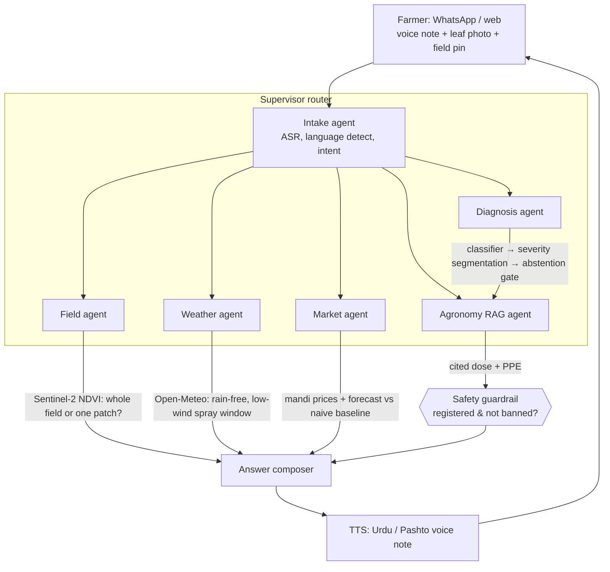
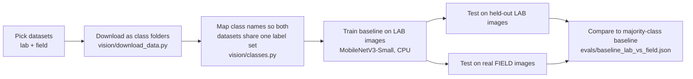

# Dehqan (دہقان)

**A voice-first crop doctor and market advisor for Pakistani farmers.**

A farmer sends a voice note (Urdu / Pashto / Punjabi) and a photo of a sick leaf. Dehqan diagnoses the problem, grades how severe it is, recommends **only pesticides registered in Pakistan** with dose and safety gear taken from cited official advisories, checks the field from satellite, finds a safe spray window from the weather forecast, suggests whether to sell or hold at the mandi, and answers as a **spoken voice note** in the farmer's language.

> **Live API: https://dehqan.onrender.com** (`/health`, `/docs`). Free hosting: it sleeps after ~15 minutes idle, so the first request can take up to a minute; a diagnosis then takes about 2 seconds.
>
> **Status: work in progress. Milestones 1 and 2 are done, and there is a working API and website; the pesticide-advice, voice, satellite and market parts are not built.** This README separates what is **built and measured** from what is **planned**. Nothing in the "Built" section is aspirational.

---

## Why this exists

Most Pakistani farmers get spray advice from the pesticide dealer, who is also the person selling the product. Dehqan is meant to be a neutral second opinion that is honest about what it does not know:

- When the diagnosis is uncertain, it **abstains** and points the farmer to the local agriculture extension office instead of guessing.
- Dose, timing and protective gear **never come from an LLM's memory**. They come from a retrieved, cited document.
- It never recommends a pesticide that is unregistered or banned in Pakistan.

---

## Architecture

### Target system (what we are building toward)



| Component | Job | Tech |
|---|---|---|
| Intake agent | Speech-to-text, language detection, route the request | Whisper / MMS |
| Diagnosis agent | Disease classifier, lesion-area severity, "not a crop / not sure" gate | PyTorch, HF Transformers |
| Agronomy RAG agent | Cited treatment from advisories + registered-pesticide list | Embeddings + Chroma |
| Safety guardrail | Blocks unregistered/banned chemicals; dose and PPE only from sources | Rules + red-team eval |
| Field agent | Sentinel-2 NDVI history for the farmer's plot | Copernicus |
| Weather agent | Spray window from forecast | Open-Meteo |
| Market agent | Mandi price history, forecast, sell/hold with confidence band | Time-series model |
| Voice reply | Spoken answer in the farmer's language | MMS-TTS |

**Planned stack:** Python 3.12 · FastAPI (ONNX Runtime at inference) · `uv` · pytest · Docker → Render · Next.js + TypeScript + Tailwind → Vercel · Langfuse tracing · GitHub Actions eval gate.

### Repo layout

```
backend/
  app/            FastAPI app, diagnosis pipeline, spray window  (built)
  vision/         data download, training, eval          (built: M1)
  voice/          ASR / TTS                              (planned)
  rag/            safety guardrail (built); retrieval (planned)
  data_sources/   Open-Meteo (built); Sentinel, mandi (planned)
  tests/          pytest
evals/            committed eval results (JSON)
data/             gitignored; download scripts only are committed
frontend/         Next.js app                            (built)
```

---

## What runs today

An end-to-end slice you can run locally (see "Run it"):

| Piece | What it does | Where |
|---|---|---|
| `POST /diagnose` | Photo in; checks it is a leaf (CLIP), names a likely condition or says "not sure", and estimates severity. Always returns `limitations` for the UI to show | `backend/app/` |
| `POST /spray-window` | Live 5-day Open-Meteo forecast in; low-wind, dry, mild-weather hours out (thresholds are rules of thumb, and the response says so) | `backend/app/spray_window.py` |
| Safety guardrail | Rejects banned or unregistered pesticides and any dose not quoted verbatim from a cited source. Not yet wired to the API: it has no pesticide data to work with | `backend/rag/guardrail.py` |
| Website | Home with an English and Urdu explanation and an animated map showing **real live weather** for 8 farming-region cities (Open-Meteo, refreshed every 10 minutes), diagnose (upload or camera), spray window (hour-by-hour grid), and a "How we measured accuracy" page that reads the real eval files | `frontend/` |

Production safeguards in the API: upload type and size limits, photos downscaled before inference, per-IP rate limiting, CORS restricted to configured origins, and a 503 when models are not loaded. 72 backend tests pass, using fakes for the models and the weather service so they need no network.

**Honest limits of the app right now:** the classifier covers 27 conditions across 14 crops, and **wheat and cotton are not among them**. At the live confidence setting (0.9) it answers about a quarter of field photos and is right on about four in five of those. It gives **no treatment advice** because the official pesticide lists are not loaded. The website was checked in a headless browser (dark theme); light mode and a full browser upload were not visually verified.

## Built so far (Milestone 1)

### Pipeline: how we got to the first real number



1. **Chose two kinds of data on purpose.** [PlantVillage](https://huggingface.co/datasets/BrandonFors/Plant-Diseases-PlantVillage-Dataset) is the standard benchmark but its photos are single leaves on plain backgrounds (lab). [PlantDoc](https://huggingface.co/datasets/Project-AgML/plant_doc_classification) is scraped from the web and looks like real fields: clutter, shadows, odd angles.
2. **Hit and fixed a download problem.** The first PlantVillage copy was ~54,000 tiny files and the Hugging Face Hub rate-limited it (HTTP 429). Switching to a parquet copy (3 large files) fixed it.
3. **Made the datasets comparable.** The two use different class names. We mapped 27 shared classes (`vision/classes.py`, unit-tested). One PlantDoc class (two-spotted spider mites) has only 2 images and is excluded.
4. **Trained a deliberately simple baseline.** ImageNet-pretrained MobileNetV3-Small, fully fine-tuned on 4,050 PlantVillage images (150 per class), 3 epochs, on a laptop CPU (~15 minutes).
5. **Evaluated honestly.** Same model, two test sets, plus a "always guess the most common class" baseline for scale.

### Result: the lab-to-field gap

| Test set | Images | Accuracy | Macro-F1 | Always-guess-majority |
|---|---|---|---|---|
| PlantVillage held-out (lab) | 1,615 | **95.5%** | 0.956 | 3.7% |
| PlantDoc (field) | 2,567 | **11.8%** | 0.089 | 3.6% |

The same model loses ~84 accuracy points when it leaves the lab. It is still about 3x better than guessing on field photos, but it is not usable. Most crop-disease demos report only the first row. **Closing this gap is the point of Milestone 2.**

**Caveats we know about**
- PlantVillage contains several photos of the same leaf, so its test split likely shares leaves with training. The 95.5% is probably optimistic.
- One run, one seed, small training subset. These are baseline numbers, not tuned ones.
- PlantDoc has no wheat or cotton. The comparison uses shared classes (tomato, potato, corn, apple, grape and others).

### Field data for Pakistan's main crops

No public dataset covers Pakistani fields, so we assembled the closest real field photos available (`vision/download_field_crops.py`):

| Crop | Source | What it is | License |
|---|---|---|---|
| Cotton | [Bangladesh cotton leaf set](https://huggingface.co/datasets/Project-AgML/cotton_leaf_disease_classification_bangladesh_2) | 2,137 photos, 7 classes incl. Curl Virus (CLCuV, a major Pakistan cotton disease) | CC-BY-4.0 |
| Cotton | [Second cotton set](https://huggingface.co/datasets/Project-AgML/cotton_leaf_disease_classification) | Different source and camera setup, used as a cross-source test set | CC-BY-NC-4.0 |
| Corn | [Anhui corn leaf set](https://huggingface.co/datasets/Project-AgML/corn_leaf_disease_classification) | 600 field photos, 6 classes | CC-BY-4.0 |

**Known gaps (not hidden):**
- **None of this is from Pakistan.** Bangladesh and China are the nearest public sources. Our own labelled Pakistani photos remain a goal.
- **No wheat.** The only public wheat-disease set we found on the Hub ([wheat_disease_detection](https://huggingface.co/datasets/Project-AgML/wheat_disease_detection)) labels its 7 classes only as `0`-`6`, and we could not verify the names from the card, Zenodo record or paper. We will not guess disease names for a product that gives spray advice.

### Cotton classifier (first Milestone 2 result)

`vision/train_cotton.py` fine-tunes the same MobileNetV3-Small on the Bangladesh cotton set (1,710 train images, 7 classes, 4 epochs, CPU, ~10 minutes). It is tested two ways: a held-out split of the same source, and the second cotton set, which came from a different group and camera setup. Results are in `evals/cotton_cross_source.json`.

**Same-source test (427 images)**

| | Accuracy | Macro-F1 | Always-guess-majority |
|---|---|---|---|
| 7-class | **82.0%** | 0.778 | 27.2% |

Per-class recall: Leaf Redding 98%, Curl Virus 98%, Leaf Variegation 96%, Healthy 88%, Bacterial Blight 78%, Herbicide Damage 73%, **Leaf Hopper Jassids 11%** (the model mostly misses this class).

**Cross-source test (551 images, only the 2 classes the sets share)**

| Scoring | Accuracy | Reference |
|---|---|---|
| Strict (pick 1 of 7 classes) | **0.5%** | |
| Shared-only (choose between the 2 shared classes) | **70.0%** | chance 50%, always-guess-majority **60.4%** |

**What this means, honestly**
- **Cross-source accuracy barely beats the dumb baseline** (70.0% vs 60.4%). The model calls almost everything "Bacterial Blight" (99% recall) and recognises only 51% of healthy leaves. It learned this one source's look, not cotton disease in general.
- **Strict accuracy is near zero:** on photos from another source the model rarely picks the right class out of all 7.
- **The 82% same-source number is probably optimistic.** Photos from the same plants and sessions likely land on both sides of the split. Treat it as an upper bound.
- This is the same lab-to-field pattern as the baseline above, now on cotton: a model that scores well on its own data does not carry over to new cameras and fields. Fixing it (stronger augmentation, training on mixed sources, confidence-based abstention) is the rest of Milestone 2.

### Abstention: saying "I'm not sure"

`vision/abstention.py` answers only when the model's top softmax probability is above a threshold, otherwise Dehqan defers to the extension office. `vision/eval_abstention.py` measures the trade-off on the cotton model (`evals/abstention_cotton.json`). *Coverage* is the share of photos answered, and *selective accuracy* is accuracy on only those.

| Test set | Answer everything | Best coverage at ≥90% accuracy | Best coverage at ≥95% accuracy |
|---|---|---|---|
| Same source (427 images) | 82.0% | **85%** of photos | **67%** of photos |
| Different source (551 images, 2 classes) | 70.0% | **27%** of photos | **25%** of photos |

- **On familiar photos abstention works well:** answering 85% of photos at 90% accuracy beats answering everything at 82%.
- **On photos from a new source it helps much less.** To reach 90% accuracy the model must defer on ~73% of photos, because it is often confidently wrong on unfamiliar cameras. Confidence is a weak safety net under distribution shift.
- **These thresholds were picked on the test data itself,** so the numbers are optimistic. A production threshold would be chosen on a separate validation split.

### Field-tuned model: how much does a little field data help?

`vision/train_field_tuned.py` retrains on PlantVillage (lab) **plus 70% of PlantDoc (field)** and tests on the held-out 30% of PlantDoc (768 images). The old lab-only baseline is scored on the *same* 768 images. Results are in `evals/field_tuned.json`.

| Model | Field accuracy | Macro-F1 | Lab accuracy | Always-guess-majority (field) |
|---|---|---|---|---|
| Lab-only baseline | **11.5%** | 0.088 | 95.5% | 3.7% |
| Lab + 1,799 field photos | **47.4%** | 0.433 | 93.3% | 7.4% |

- **Field accuracy rises about 4x (11.5% to 47.4%)** after adding 1,799 field photos, at a cost of about 2 points of lab accuracy.
- **47% is still not usable for spray advice.** More than half of field photos get the wrong label.
- **Abstention does not rescue it.** The model is overconfident: reaching 90% accuracy means answering only **9%** of photos (95% accuracy: 6%), so at this stage it would defer almost every time.
- **Caveats:** PlantDoc is scraped from the web and may contain near-duplicate photos on both sides of the split, so 47.4% may be optimistic. One run, one seed, 3 epochs on CPU with a small model; there is room to improve, and we have not yet tried a larger backbone or stronger augmentation.

### Severity grading from lesion area

Severity is the share of the leaf covered by disease spots: `spots / (spots + healthy leaf)`. `vision/train_severity.py` compares three estimators on the same held-out photos, using [PDSNet](https://huggingface.co/datasets/Project-AgML/pdsnet_field_plant_disease_segmentation): 240 field photos with pixel masks (apple cedar rust, soybean bacterial blight, **wheat stripe rust** from Henan, China), split 159 train / 81 test within each crop. Results are in `evals/severity.json`.

| Estimator | Severity error (MAE, percentage points) | Correlation with truth | Grade accuracy (mild / moderate / severe) |
|---|---|---|---|
| Naive: always predict the training mean | 13.05 | 0.00 | 42.0% |
| Colour thresholds (HSV, no learning) | 11.43 | 0.47 | 53.1% |
| **Learned segmentation** (LR-ASPP MobileNetV3, 12 epochs, CPU) | **8.01** | **0.95** | **81.5%** |

Lesion overlap (IoU) for the learned model: 0.53.

Per crop (27 test photos each): apple MAE 0.7 points, soybean 8.0, **wheat 15.4** (grade accuracy 59%, correlation 0.91).

- **The learned model clearly beats both baselines.** The colour-threshold approach is only slightly better than guessing the mean, because soil, shadows and rust are hard to tell apart by colour alone.
- **Wheat is the weak spot.** Its severity range is the widest (2% to 66%), and the model is least accurate there even though its ranking of photos is good (correlation 0.91), so its estimates look systematically off in scale. We have not yet investigated the direction of the bias.
- **Apple's 100% grade accuracy means little:** every apple photo is "mild", so guessing "mild" also scores 100%.
- **Grades are our own cut-offs** (mild below 10%, moderate 10 to 30%, severe 30% and above), chosen from the spread of this data. They are not an official agronomic scale.
- **Small test set, one run, one split.** 81 photos from three crop-disease pairs, photographed in China or from public sources. This is a proof the approach works, not evidence it will hold in Pakistani fields. The data is CC-BY-NC (non-commercial).

### Corn field test (Anhui, China)

`vision/eval_corn.py` runs the two PlantVillage-trained models on a corn dataset neither has seen, photographed in Chinese fields (`evals/corn_field.json`). Two of its six diseases (Common Rust, Northern Leaf Blight; 200 photos) are diseases our models know. The other four (400 photos) are not in their label set.

| Model | Accuracy on the 2 known diseases (all 27 classes) | Same, if told "it is corn" | Guessing one of the two |
|---|---|---|---|
| Lab-only baseline | **4.5%** | 23.0% | 50% |
| Lab + PlantDoc field-tuned | **72.0%** | 76.0% | 50% |

- **The lab-only model fails completely on real corn photos:** 4.5% is far below even a coin flip between the two diseases.
- **Field data helps a lot:** the field-tuned model reaches 72%, comfortably above the 50% guess. It saw PlantDoc corn photos but never this dataset.
- **On the 4 unseen diseases the models stay confident anyway:** the field-tuned model has mean confidence 0.69, and **20%** of those photos get >90% confidence, even though any disease name it gives is wrong. A confidence threshold alone will not catch unknown diseases. (Lab-only baseline: 23% above 90%.)
- Only one dataset and two diseases, so this is a spot check, not a corn benchmark.

### Safety guardrail (Milestone 3, started)

`rag/guardrail.py` decides whether a treatment recommendation may be shown to a farmer. It enforces the two rules the product depends on:

1. **Nothing banned or unregistered is ever recommended.** Banned wins over everything, even if the product also appears on the registered list.
2. **Every dose and every protective-gear claim must be traced to a source.** Each claim carries a citation (source id + exact quote). The guardrail checks that the quote really appears in that source, and that the dose or PPE wording appears inside the quote. A claim that cannot be traced is rejected, however plausible it sounds.

Outcomes: `approved`, `no_dose` (registered, but no dose to give, so the farmer is sent to the extension office), or `rejected`.

**A bug the tests caught:** the first version matched with plain substring search, which would accept a dose of "20 ml per acre" against a source saying "1**20** ml per acre", or "5 ml" against "0.5 ml". For a pesticide that is a dangerous false accept. Matching is now whole-token and number-aware (tests: `tests/test_guardrail.py`, 14 cases).

**What it does not do:** it proves a dose is *traceable* to a document, not that the sentence means what we think. A source saying "do NOT spray more than 200 ml" would still verify the dose "200 ml". That is why the faithfulness eval and red-team suite (still to build) matter.

**Blocked on data:** the registered and banned lists are *inputs*, and we do not yet have them. Searches point to the Punjab Agriculture Department's crop-wise agrochemical list (with WHO hazard class and antidotes) and the federal Department of Plant Protection, but from our machine those sites did not resolve, and we will not invent a pesticide list. The official wheat-rust advisories we found also appear to tell farmers to follow local expert advice and, as far as we could see, give no dose. If that holds, the honest product behaviour for wheat rust is often `no_dose` plus a referral, not a made-up number.

### Running on a 512 MB host: the ONNX backend

Render's free tier has 512 MB of RAM. The PyTorch version of the pipeline needs about **909 MB** (PyTorch alone is 292 MB, and the first request pushes it far higher), so it cannot run there. The server therefore runs on **ONNX Runtime**, with no PyTorch installed:

| | PyTorch (development) | ONNX Runtime (deployed) |
|---|---|---|
| RAM, all 3 models loaded and running | ~909 MB | **~213-220 MB** (measured on the real server after repeated requests) |
| Time per photo, dev PC full CPU | about 1 s | about 0.2 s |
| Needs PyTorch installed | yes | no (a test enforces this) |

How: `vision/export_onnx.py` exports the classifier and segmenter, exports only CLIP's *image* half, computes CLIP's text embeddings once instead of on every request, and quantises CLIP's image half to int8 (351 MB to 88 MB). `vision/check_onnx_parity.py` then compares the ONNX models with the PyTorch ones on the same 500 leaf and 500 non-crop photos used for the gate evaluation (`evals/onnx_parity.json`):

| Model | Agreement with PyTorch |
|---|---|
| Disease classifier | same top label on **100%** of 500 photos; confidence differs by at most 0.00001 |
| Severity | same grade on **100%** of 500; severity differs by at most 0.001 percentage points |
| "Not a crop" gate (int8 CLIP) | same decision on **NaN%** of 1000 photos (1 photo differs; one score moved by up to 0.3573) |

Gate accuracy on ONNX: accepts **99.8%** of leaf photos and wrongly accepts **1.0%** of non-crop photos (AUROC 0.9992), against 99.6% / 1.0% (AUROC 0.9997) on PyTorch. The 0.2-point difference in accepted leaves is one photo, i.e. noise; the slightly lower AUROC is the cost of quantisation. All model evaluations above (accuracy, abstention, severity) were measured with PyTorch; the parity table is the evidence that the deployed models behave the same.

**On Render's free CPU** a diagnosis takes about **2 seconds** end to end as seen from Pakistan (5 consecutive requests: 1.8 to 2.7 s, including the network), and the live service returned the same gate score as the local one, to the last digit.

### "Not a crop" gate (zero-shot CLIP)

`vision/crop_gate.py` uses CLIP with no training: it scores a photo against text prompts for leaves ("a close-up photo of a healthy plant leaf", ...) and for other things ("a photo of a person", "a vehicle", ...), and rejects the photo if the leaf prompts hold less than half the probability. Dehqan then asks for a clearer leaf photo instead of diagnosing a dog. `vision/eval_crop_gate.py` tests it on 500 leaf photos (100 each from PlantVillage, PlantDoc, both cotton sets and corn) and 500 non-crop photos (Caltech-101), and compares it with a tempting shortcut: rejecting photos where the disease classifier's own confidence is low. Results: `evals/crop_gate.json`.

| Method | Leaf photos accepted | Non-crop photos wrongly accepted | AUROC | Leaf photos accepted at ≤5% false accepts |
|---|---|---|---|---|
| **CLIP zero-shot gate** | **99.6%** | **1.0%** | **0.9997** | **99.8%** |
| Classifier confidence (the shortcut) | n/a | n/a | 0.675 | 23.6% |

- **CLIP separates the two groups almost perfectly, and the shortcut does not work.** A classifier's confidence is a poor "is this a leaf?" detector (AUROC 0.67), because it is often confident on photos it has never seen. This matches the corn result above.
- **No tuning on the test set:** the threshold is the default 0.5 and the prompts were written before testing. The lowest per-source acceptance is 98% (PlantDoc field photos).
- **This test is easy, so treat the numbers as an upper bound.** The negatives are everyday objects, faces and animals, and some of our "other" prompts name similar things, which flatters the result. We have **not** tested the cases that matter most to a farmer: bare soil, weeds, fruit, or a hand holding a leaf. Those need their own test set before this gate is trusted.

---

## Honest-evaluation principles

These apply to every model in this repo:

1. Every model gets an eval with real numbers, including bad ones.
2. Never test on training data; always compare against a simple baseline.
3. If something does not beat the baseline, the README and the UI say so.
4. The safety red-team suite must pass 100% in CI before any deploy.

## Roadmap

- [x] **M1 Scaffold & data:** repo, dataset scripts, baseline, lab-vs-field eval, field crop sets
- [x] **M2 Diagnosis v2:** field-tuned model, severity segmentation, "not a crop" gate, abstention (coverage vs accuracy). *Done, with caveats: field accuracy rose from 11.5% to 47.4% but is still not usable for advice; severity grade accuracy 81.5% vs 42% baseline (wheat weakest); "not a crop" gate accepts 99.6% of leaf photos and wrongly accepts 1% of everyday objects (hard cases like soil and weeds untested).*
- [ ] **M3 Agronomy RAG + safety:** cited answers, registered-pesticide guardrail, red-team suite. *Started: guardrail logic and tests done; blocked on obtaining the official registered/banned lists and advisory PDFs.*
- [ ] **M4 Voice:** Urdu + Pashto ASR/TTS, WER eval
- [ ] **M5 Field / weather / market agents + supervisor router.** *Weather agent done (spray windows); satellite, market and the supervisor router not started.*
- [ ] **M6 Live product:** Render backend, Vercel frontend, WhatsApp sandbox, rate limits. *API deployed on Render (free) and verified live; website built and checked against it, Vercel deploy pending. CI workflow, PyTorch-free ONNX backend and a step-by-step guide ([docs/DEPLOY.md](docs/DEPLOY.md)) are done.*
- [ ] **M7 LLMOps:** Langfuse, CI eval gate, drift monitoring, nightly refresh

Fallback scope if time is tight: 2 crops (wheat, cotton), 2 languages (Urdu, Pashto), 1 mandi region.

## Run it

Requires [uv](https://docs.astral.sh/uv/), Python 3.12, and Node 20+ for the website. Everything runs on CPU.

**Run the app** (needs the model files from the training steps below in `data/models/`):

```powershell
cd backend
uv run uvicorn app.main:app --port 8000          # API docs at http://127.0.0.1:8000/docs
# in a second terminal:
cd frontend
npm install
npm run dev                                      # website at http://localhost:3000
```

The API uses the ONNX models when `data/models/onnx/` exists (`DEHQAN_BACKEND=torch` forces PyTorch). Set `DEHQAN_LOAD_MODELS=0` to start the API without models (`/diagnose` then answers 503; `/spray-window` still works).

**Reproduce the evaluations:**

```powershell
cd backend
uv sync
uv run pytest                                   # unit tests
uv run python -m vision.download_data           # PlantVillage + PlantDoc into ../data
uv run python -m vision.download_field_crops    # cotton + corn field sets
uv run python -m vision.train_baseline          # ~15 min on CPU; writes ../evals/baseline_lab_vs_field.json
uv run python -m vision.train_cotton            # ~10 min on CPU; writes ../evals/cotton_cross_source.json
uv run python -m vision.eval_abstention         # seconds; writes ../evals/abstention_cotton.json
uv run python -m vision.train_field_tuned       # ~27 min on CPU; writes ../evals/field_tuned.json
uv run python -m vision.download_pdsnet         # 11 MB: field photos with lesion masks
uv run python -m vision.train_severity          # ~22 min on CPU; writes ../evals/severity.json
uv run python -m vision.download_negatives      # Caltech-101 non-crop photos, for the "not a crop" gate
uv run python -m vision.download_clip           # CLIP model files (~600 MB)
uv run python -m vision.export_onnx             # exports the deployed ONNX models to data/models/onnx/
uv run python -m vision.check_onnx_parity       # ONNX vs PyTorch on 1,000 photos; writes ../evals/onnx_parity.json
```

Datasets and model weights are gitignored. Only the download scripts and eval results are committed.

## Data licenses and credits

PlantVillage and PlantDoc are public research datasets; the field crop sets are redistributed by the [AgML project](https://project-agml.github.io/) on the Hugging Face Hub under the licenses listed above. Check each dataset card before commercial use: one cotton set and the PDSNet severity data are CC-BY-NC, so the **severity weights are non-commercial**; a commercial product would need models retrained on data you may use commercially.
