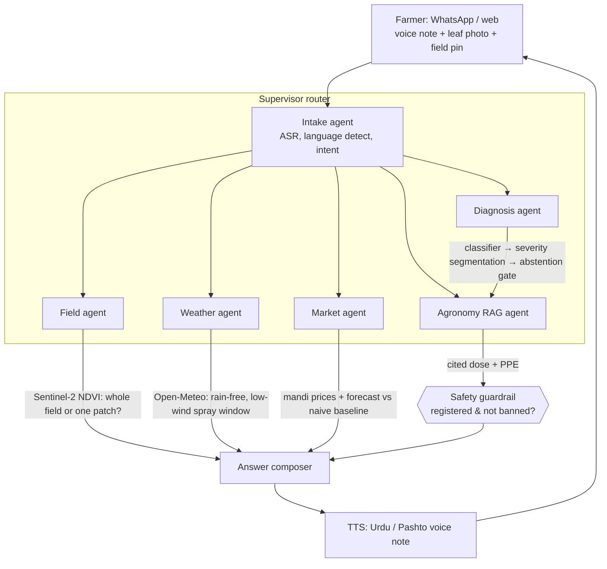
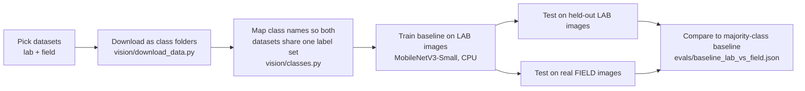

# Dehqan (دہقان)

**A voice-first crop doctor and market advisor for Pakistani farmers.**

A farmer sends a voice note (Urdu / Pashto / Punjabi) and a photo of a sick leaf. Dehqan diagnoses the problem, grades how severe it is, recommends **only pesticides registered in Pakistan** with dose and safety gear taken from cited official advisories, checks the field from satellite, finds a safe spray window from the weather forecast, suggests whether to sell or hold at the mandi, and answers as a **spoken voice note** in the farmer's language.

> **Status: work in progress (Milestone 1 of 7).** This README separates what is **built and measured** from what is **planned**. Nothing in the "Built" section is aspirational.

---

## Why this exists

Most Pakistani farmers get spray advice from the pesticide dealer, who is also the person selling the product. Dehqan is meant to be a neutral second opinion that is honest about what it does not know:

- When the diagnosis is uncertain, it **abstains** and points the farmer to the local agriculture extension office instead of guessing.
- Dose, timing and protective gear **never come from an LLM's memory**. They come from a retrieved, cited document.
- It never recommends a pesticide that is unregistered or banned in Pakistan.

---

## Architecture

### Target system (what we are building toward)



| Component | Job | Tech |
|---|---|---|
| Intake agent | Speech-to-text, language detection, route the request | Whisper / MMS |
| Diagnosis agent | Disease classifier, lesion-area severity, "not a crop / not sure" gate | PyTorch, HF Transformers |
| Agronomy RAG agent | Cited treatment from advisories + registered-pesticide list | Embeddings + Chroma |
| Safety guardrail | Blocks unregistered/banned chemicals; dose and PPE only from sources | Rules + red-team eval |
| Field agent | Sentinel-2 NDVI history for the farmer's plot | Copernicus |
| Weather agent | Spray window from forecast | Open-Meteo |
| Market agent | Mandi price history, forecast, sell/hold with confidence band | Time-series model |
| Voice reply | Spoken answer in the farmer's language | MMS-TTS |

**Planned stack:** Python 3.12 · FastAPI · `uv` · pytest · Docker → Render · Next.js + TypeScript + Tailwind → Vercel · Langfuse tracing · GitHub Actions eval gate.

### Repo layout

```
backend/
  app/            FastAPI app, agents, routers          (planned)
  vision/         data download, training, eval          (built: M1)
  voice/          ASR / TTS                              (planned)
  rag/            ingestion, retrieval, safety guardrail (planned)
  data_sources/   Open-Meteo, Sentinel, mandi scraper    (planned)
  tests/          pytest
evals/            committed eval results (JSON)
data/             gitignored; download scripts only are committed
frontend/         Next.js app                            (planned)
```

---

## Built so far (Milestone 1)

### Pipeline: how we got to the first real number



1. **Chose two kinds of data on purpose.** [PlantVillage](https://huggingface.co/datasets/BrandonFors/Plant-Diseases-PlantVillage-Dataset) is the standard benchmark but its photos are single leaves on plain backgrounds (lab). [PlantDoc](https://huggingface.co/datasets/Project-AgML/plant_doc_classification) is scraped from the web and looks like real fields: clutter, shadows, odd angles.
2. **Hit and fixed a download problem.** The first PlantVillage copy was ~54,000 tiny files and the Hugging Face Hub rate-limited it (HTTP 429). Switching to a parquet copy (3 large files) fixed it.
3. **Made the datasets comparable.** The two use different class names. We mapped 27 shared classes (`vision/classes.py`, unit-tested). One PlantDoc class (two-spotted spider mites) has only 2 images and is excluded.
4. **Trained a deliberately simple baseline.** ImageNet-pretrained MobileNetV3-Small, fully fine-tuned on 4,050 PlantVillage images (150 per class), 3 epochs, on a laptop CPU (~15 minutes).
5. **Evaluated honestly.** Same model, two test sets, plus a "always guess the most common class" baseline for scale.

### Result: the lab-to-field gap

| Test set | Images | Accuracy | Macro-F1 | Always-guess-majority |
|---|---|---|---|---|
| PlantVillage held-out (lab) | 1,615 | **95.5%** | 0.956 | 3.7% |
| PlantDoc (field) | 2,567 | **11.8%** | 0.089 | 3.6% |

The same model loses ~84 accuracy points when it leaves the lab. It is still about 3x better than guessing on field photos, but it is not usable. Most crop-disease demos report only the first row. **Closing this gap is the point of Milestone 2.**

**Caveats we know about**
- PlantVillage contains several photos of the same leaf, so its test split likely shares leaves with training. The 95.5% is probably optimistic.
- One run, one seed, small training subset. These are baseline numbers, not tuned ones.
- PlantDoc has no wheat or cotton. The comparison uses shared classes (tomato, potato, corn, apple, grape and others).

### Field data for Pakistan's main crops

No public dataset covers Pakistani fields, so we assembled the closest real field photos available (`vision/download_field_crops.py`):

| Crop | Source | What it is | License |
|---|---|---|---|
| Cotton | [Bangladesh cotton leaf set](https://huggingface.co/datasets/Project-AgML/cotton_leaf_disease_classification_bangladesh_2) | 2,137 photos, 7 classes incl. Curl Virus (CLCuV, a major Pakistan cotton disease) | CC-BY-4.0 |
| Cotton | [Second cotton set](https://huggingface.co/datasets/Project-AgML/cotton_leaf_disease_classification) | Different source and camera setup, used as a cross-source test set | CC-BY-NC-4.0 |
| Corn | [Anhui corn leaf set](https://huggingface.co/datasets/Project-AgML/corn_leaf_disease_classification) | 600 field photos, 6 classes | CC-BY-4.0 |

**Known gaps (not hidden):**
- **None of this is from Pakistan.** Bangladesh and China are the nearest public sources. Our own labelled Pakistani photos remain a goal.
- **No wheat.** The only public wheat-disease set we found on the Hub ([wheat_disease_detection](https://huggingface.co/datasets/Project-AgML/wheat_disease_detection)) labels its 7 classes only as `0`-`6`, and we could not verify the names from the card, Zenodo record or paper. We will not guess disease names for a product that gives spray advice.

---

## Honest-evaluation principles

These apply to every model in this repo:

1. Every model gets an eval with real numbers, including bad ones.
2. Never test on training data; always compare against a simple baseline.
3. If something does not beat the baseline, the README and the UI say so.
4. The safety red-team suite must pass 100% in CI before any deploy.

## Roadmap

- [x] **M1 Scaffold & data:** repo, dataset scripts, baseline, lab-vs-field eval, field crop sets
- [ ] **M2 Diagnosis v2:** field-tuned model, severity segmentation, "not a crop" gate, abstention (coverage vs accuracy)
- [ ] **M3 Agronomy RAG + safety:** cited answers, registered-pesticide guardrail, red-team suite
- [ ] **M4 Voice:** Urdu + Pashto ASR/TTS, WER eval
- [ ] **M5 Field / weather / market agents + supervisor router**
- [ ] **M6 Live product:** Render backend, Vercel frontend, WhatsApp sandbox, rate limits
- [ ] **M7 LLMOps:** Langfuse, CI eval gate, drift monitoring, nightly refresh

Fallback scope if time is tight: 2 crops (wheat, cotton), 2 languages (Urdu, Pashto), 1 mandi region.

## Run it

Requires [uv](https://docs.astral.sh/uv/) and Python 3.12. Everything runs on CPU.

```powershell
cd backend
uv sync
uv run pytest                                   # unit tests
uv run python -m vision.download_data           # PlantVillage + PlantDoc into ../data
uv run python -m vision.download_field_crops    # cotton + corn field sets
uv run python -m vision.train_baseline          # ~15 min on CPU; writes ../evals/baseline_lab_vs_field.json
```

Datasets and model weights are gitignored. Only the download scripts and eval results are committed.

## Data licenses and credits

PlantVillage and PlantDoc are public research datasets; the field crop sets are redistributed by the [AgML project](https://project-agml.github.io/) on the Hugging Face Hub under the licenses listed above. Check each dataset card before commercial use: one cotton set is CC-BY-NC.
